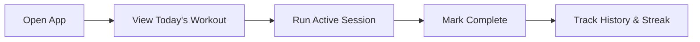
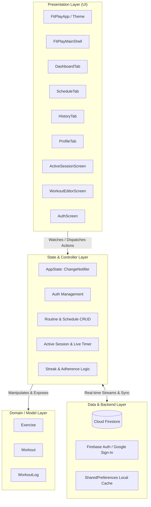
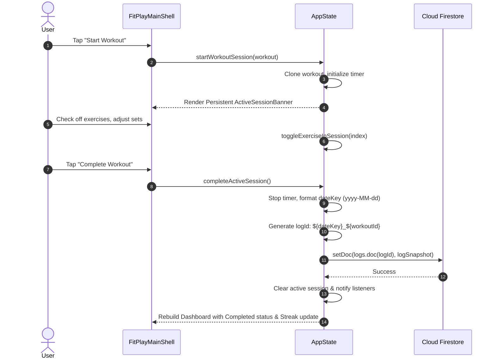

# FitPlay 🏋️‍♂️

> **High-performance, focused workout planner and training tracker built with Flutter and Google Firebase.**

FitPlay is an intuitive, distraction-free mobile fitness application engineered for athletes and gym-goers who follow split training routines (Push/Pull/Legs, Upper/Lower, or custom splits). It replaces clumsy notes apps and bloated spreadsheets with an ultra-responsive, zero-friction workout tracking experience.

---

## 📑 Table of Contents

- [Overview & Philosophy](#-overview--philosophy)
- [Key Features](#-key-features)
- [System Architecture](#-system-architecture)
  - [Architectural Pattern (MVVM + Provider)](#architectural-pattern-mvvm--provider)
  - [Domain & Data Models](#domain--data-models)
  - [Application State & Controller (AppState)](#application-state--controller-appstate)
  - [Data Architecture & Firestore Schema](#data-architecture--firestore-schema)
  - [Session Lifecycle & Deterministic Logging](#session-lifecycle--deterministic-logging)
- [Project Structure](#-project-structure)
  - [Directory Tree](#directory-tree)
  - [Source Code Breakdown (`lib/`)](#source-code-breakdown-lib)
- [Design System & Aesthetics](#-design-system--aesthetics)
- [Tech Stack & Dependencies](#-tech-stack--dependencies)
- [Getting Started](#-getting-started)
  - [Prerequisites](#prerequisites)
  - [Installation & Running](#installation--running)
  - [Firebase Configuration](#firebase-configuration)
  - [Testing](#testing)
  - [Building for Release](#building-for-release)
- [Security & Rules](#-security--rules)
- [Roadmap](#-roadmap)

---

## ⚡ Overview & Philosophy

Most fitness apps suffer from feature bloat, complex menus, and slow navigation that hinder lifters between sets. **FitPlay** is designed around a single core loop:



### Core Principles
1. **Zero Tap Overhead**: The instant the app opens, today's scheduled workout is front and center. No drill-down menus needed.
2. **Built for the Gym Floor**: High-contrast typography, large touch targets (48x48+ dp), and one-handed operation suitable for sweaty or chalk-covered hands.
3. **Immutable History**: Historical logs store complete snapshots of the workout performed, ensuring future edits to a routine never alter past logs.
4. **Cloud-Synced & Offline-Resilient**: Seamless multi-device synchronization via Cloud Firestore with local fallbacks and default template seeding.

---

## ✨ Key Features

### 📅 Smart Today Dashboard
- **Instant Day Detection**: Automatically queries today's ISO weekday (`1 = Monday` to `7 = Sunday`) and displays assigned workouts.
- **Stacked Routine Support**: Handles multi-session days seamlessly.
- **Rest Day States**: Clean empty states with quick shortcuts to schedule or review workout routines.
- **Weekly Adherence Strip**: Interactive 7-day indicator showing scheduled vs. completed workout days.
- **Weekly Streak Counter**: Dynamically computes consecutive weeks of 100% adherence to scheduled routines.
- **Same-Day Undo**: Allows reversing accidental completion directly from the dashboard.

### 🗓️ Weekly Split Planner
- **Weekday Matrix**: Drag-and-drop / single-tap assignment of routines to specific days of the week.
- **Built-in Templates**: Preloaded with balanced foundational splits:
  - *Push Day* (Chest, Delts, Triceps)
  - *Pull Day* (Back, Rear Delts, Biceps)
  - *Leg Day* (Quads, Hamstrings, Calves)
  - *Upper Body Power*
  - *Lower Body Hypertrophy*
- **Routine Library**: Centralized repository of active routines with category badges (`push`, `pull`, `legs`, `upper`, `lower`, `custom`).

### 🛠️ Workout & Exercise Editor
- **Custom Routine Creation**: Build custom workouts with arbitrary exercise counts.
- **Granular Weight System**:
  - Uniform set weights or individual set weights (ideal for pyramids, drop sets, and warm-up progressions).
  - Dynamic weight formatting summary (e.g., `70 · 80 · 90 kg`).
- **Exercise Configuration**: Custom target sets, reps, weight, and tactical exercise notes.
- **Soft Deletion / Archival**: Workouts can be archived to retain integrity with historical logs while removing them from active schedules.

### ⏱️ Active Workout Session & Live Tracker
- **Real-Time Duration Timer**: Embedded stopwatch keeping precise session duration in seconds.
- **Persistent Global Banner**: Running sessions display a floating banner across all tabs, allowing navigation without losing session context.
- **Set & Exercise Checklists**: Interactive checkmarks for exercises completed during training.
- **Live Override**: Edit weights and reps on the fly during an active workout session.

### 📜 Historical Logs & Analytics
- **Reverse Chronological Timeline**: Browse past completed sessions grouped by date and routine.
- **Deep Performance Snapshots**: Detailed breakdowns of sets, weights, durations, and exercise completion states.

### 👤 Profile, Units & Theme
- **Dual Weight Unit Support**: Instant toggle between Metric (`kg`) and Imperial (`lb`).
- **OLED Monochrome Theme**: Battery-saving high-contrast pure black and white theme with toggleable light mode.
- **Cloud Sync Inspector**: Live visual indicator of Firebase Firestore connectivity and active collection paths.

---

## 🏛️ System Architecture

FitPlay is built using a clean, reactive **Layered MVVM (Model-View-ViewModel)** architectural pattern powered by Flutter's `Provider` and `ChangeNotifier`.



### Architectural Pattern (MVVM + Provider)

1. **View (Presentation Layer)**:
   - Declarative Flutter widgets that subscribe to state using `context.watch<AppState>()` or dispatch user intents using `context.read<AppState>()`.
   - Widgets are strictly decoupled from Firestore queries and business logic.
   - Screen states reactively rebuild when notification dispatches occur.

2. **ViewModel / Controller (`AppState`)**:
   - Single source of truth extending `ChangeNotifier`.
   - Exposes unmodifiable lists (`logs`, `workouts`, `weeklySchedule`).
   - Manages asynchronous lifecycle events, authentication status, local timers, and synchronization transitions.

3. **Domain / Model Layer**:
   - Pure Dart classes with deterministic serialization (`toMap` / `fromMap`), immutable cloning helpers (`copyWith`), and domain formatting logic.

---

### Domain & Data Models

#### 1. `Exercise`
Represents an individual exercise movement within a workout routine.
```dart
class Exercise {
  final String id;
  String name;
  int sets;
  int reps;
  double? weight;
  List<double>? setWeights; // Supports per-set weight progression
  String? notes;
  bool isCompleted;
  
  List<double> getEffectiveSetWeights();
  String formatWeightsSummary(String units);
}
```

#### 2. `Workout`
Represents a structured training routine assigned to a category.
```dart
class Workout {
  final String id;
  String name;
  String category; // 'push' | 'pull' | 'legs' | 'upper' | 'lower' | 'custom'
  List<Exercise> exercises;
  bool archived; // Preserves historical integrity on deletion
}
```

#### 3. `WorkoutLog`
An immutable historical record generated when an active session is completed.
```dart
class WorkoutLog {
  final String id;             // Formatted as '{yyyy-MM-dd}_{workoutId}'
  final String workoutId;      // Foreign reference to routine
  final String workoutName;    // Snapshot of name at completion time
  final String category;       // Snapshot of category
  final String date;           // 'yyyy-MM-dd' for deterministic querying
  final DateTime completedAt;
  final int durationSeconds;
  final List<Exercise> exercises; // Snapshot of performed exercises & weights
}
```

---

### Application State & Controller (`AppState`)

`AppState` is the operational brain of FitPlay, orchestrating:
- **Authentication Lifecycle**: Interacts with `FirebaseAuth` and `GoogleSignIn`, listening to auth state shifts and resetting or restoring user data accordingly.
- **Data Synchronization**: Synchronizes routines to `users/{uid}/workouts`, completed logs to `users/{uid}/logs`, and weekly schedule mappings to `users/{uid}/meta/schedule`.
- **Live Session Engine**: Manages `_sessionTimer = Timer.periodic(...)` for tracking elapsed training seconds without blocking the UI thread.
- **Streak Calculation**: Implements an adherence evaluation algorithm:
  $$\text{Streak} = \sum \text{consecutive weeks where every scheduled workout has a corresponding log}$$
- **Offline Fallback & Bootstrapping**: Automatically seeds standard routine templates (`push-1`, `pull-1`, `legs-1`, etc.) when offline or newly registered.

---

### Data Architecture & Firestore Schema

All cloud data is scoped strictly under the authenticated user's unique identifier (`uid`), enforcing strict tenant isolation:

```
firestore-root/
└── users/
    └── {uid}/
        ├── workouts/
        │   └── {workoutId}/
        │       ├── id: string
        │       ├── name: string
        │       ├── category: "push" | "pull" | "legs" | "upper" | "lower" | "custom"
        │       ├── exercises: Array<ExerciseMap>
        │       ├── archived: boolean
        │       └── updatedAt: timestamp
        │
        ├── logs/
        │   └── {yyyy-MM-dd}_{workoutId}/   <-- Deterministic Composite Key
        │       ├── id: string
        │       ├── workoutId: string
        │       ├── workoutName: string
        │       ├── category: string
        │       ├── date: "yyyy-MM-dd"
        │       ├── completedAt: timestamp
        │       ├── durationSeconds: int
        │       └── exercises: Array<ExerciseSnapshotMap>
        │
        └── meta/
            └── schedule/
                └── (doc): {
                    "1": ["push-1"],     // Monday
                    "2": ["pull-1"],     // Tuesday
                    "3": [],             // Wednesday (Rest)
                    "4": ["legs-1"],     // Thursday
                    "5": ["upper-1"],    // Friday
                    "6": [],             // Saturday (Rest)
                    "7": []              // Sunday (Rest)
                }
```

---

### Session Lifecycle & Deterministic Logging

To avoid accidental double-counting and to maintain historical accuracy, FitPlay uses an idempotent logging pipeline:



---

## 📁 Project Structure

### Directory Tree

```
FitPlay/
├── android/                     # Android native project and Gradle scripts
├── ios/                         # iOS native Xcode project and Podfile
├── web/                         # Web platform support assets
├── linux/                       # Linux desktop runner
├── macos/                       # macOS desktop runner
├── windows/                     # Windows desktop runner
│
├── assets/                      # Static branding assets
│   ├── icon/                    # App launcher icons & adaptive icons
│   │   ├── app_icon.png
│   │   └── app_icon_foreground.png
│   └── images/                  # Promotional & interface images
│
├── lib/                         # Application source code
│   ├── main.dart                # Complete application codebase & layers
│   └── firebase_options.dart    # Auto-generated Firebase client configuration
│
├── test/                        # Automated testing suite
│   └── widget_test.dart         # Widget, auth, and state verification tests
│
├── FitTrack_Project_Spec.md     # Architectural requirements & technical specification
├── pubspec.yaml                 # Package dependencies, fonts, and assets definition
├── analysis_options.yaml        # Strict Dart linting rules and static analysis
└── README.md                    # Project documentation
```

---

### Source Code Breakdown (`lib/`)

The core architecture in [`lib/main.dart`](file:///c:/Users/Z59078/Desktop/FitPlay/lib/main.dart) is organized into clear, maintainable sections:

| Section Line Range | Architectural Module | Description |
|:---|:---|:---|
| **Lines 1 – 35** | **App Bootstrap & Initialization** | Firebase setup, SharedPreferences hydration, and Provider injection (`ChangeNotifierProvider`). |
| **Lines 36 – 253** | **Domain Layer (Data Models)** | Definitions for `Exercise`, `Workout`, and `WorkoutLog` with serialization and weight formatting. |
| **Lines 254 – 1298** | **Application State (`AppState`)** | Central ViewModel managing Auth, Firestore collections, weekly schedules, live workout sessions, and streaks. |
| **Lines 1299 – 1637** | **Theme & Root Widget (`FitPlayApp`)** | Custom high-contrast monochrome design system, theme tokens, and typography. |
| **Lines 1638 – 2045** | **Auth Flow (`AuthScreen`)** | Email/Password validation, registration, password recovery, and Google Sign-In handlers. |
| **Lines 2046 – 2206** | **Main Shell Navigation** | Bottom navigation bar (`NavigationBar`), `IndexedStack` preservation, and floating active session widget (`_ActiveSessionBanner`). |
| **Lines 2207 – 3309** | **Tab 1: Today Dashboard** | Today's routines, rest day states, week adherence strip, streak cards, and workout action triggers. |
| **Lines 3310 – 3748** | **Tab 2: Weekly Schedule** | Weekly routine planner (Mon–Sun), day-assignment modal, and routine catalog. |
| **Lines 3749 – 4837** | **Workout Creator & Editor** | Full routine editing screen, exercise creation form, pyramid set weight builder, and soft-delete/archive. |
| **Lines 4838 – 5194** | **Active Session Screen** | Live workout tracker with real-time stopwatch, exercise checkboxes, and session completion pipeline. |
| **Lines 5195 – 5448** | **Tab 3: Workout History** | Reverse chronological activity log, duration indicators, and completed set reviews. |
| **Lines 5449 – 5978** | **Tab 4: Profile & Settings** | User account profile, kg/lb unit toggles, account deletion, and Firestore sync status modal. |

---

## 🎨 Design System & Aesthetics

FitPlay features a bespoke, distraction-free **High-Contrast Monochrome Design System**:

- **Dark Mode First**: Tailored for OLED displays (`#000000` pitch black background, `#121214` surface containers, `#27272A` borders) to minimize battery consumption in gyms.
- **Accents**: Pure crisp white (`#FFFFFF`) primary actions, subtle slate neutrals (`#71717A`), and vivid Emerald Green (`#10B981`) for completed statuses and streak highlights.
- **Typography**: Clean, geometric modern typography powered by Google Fonts, optimized for legibility at arm's length.
- **Ergonomics**: Primary buttons and interactive checklist tiles adhere to a minimum size of 48×48 dp to accommodate rapid tapping during heavy physical exertion.

---

## 🛠️ Tech Stack & Dependencies

| Category | Package / Tool | Version | Purpose |
|:---|:---|:---|:---|
| **Framework** | [Flutter](https://flutter.dev) | SDK `^3.13.5` | Cross-platform mobile development (iOS & Android) |
| **Language** | [Dart](https://dart.dev) | SDK `>=3.1.0` | Strongly typed, compiled client programming language |
| **State Management** | [`provider`](https://pub.dev/packages/provider) | `^6.1.5` | Reactive state management and dependency injection |
| **Backend & Auth** | [`firebase_core`](https://pub.dev/packages/firebase_core) | `^4.15.0` | Firebase initialization & options loading |
| | [`firebase_auth`](https://pub.dev/packages/firebase_auth) | `^6.7.0` | User authentication (Email/Password & OAuth) |
| | [`google_sign_in`](https://pub.dev/packages/google_sign_in) | `^7.2.0` | Native Google OAuth authentication provider |
| **Database** | [`cloud_firestore`](https://pub.dev/packages/cloud_firestore) | `^6.10.0` | Real-time NoSQL cloud database with offline caching |
| **Local Storage** | [`shared_preferences`](https://pub.dev/packages/shared_preferences) | `^2.5.6` | Lightweight persistence for theme & local settings |
| **Typography & UI** | [`google_fonts`](https://pub.dev/packages/google_fonts) | `^6.3.3` | Dynamic font rendering (Inter / Outfit / Roboto) |
| | [`cupertino_icons`](https://pub.dev/packages/cupertino_icons) | `^1.0.8` | iOS style icon assets |
| **Formatting** | [`intl`](https://pub.dev/packages/intl) | `^0.20.3` | Date formatting and locale handling |
| **Testing** | [`flutter_test`](https://api.flutter.dev/flutter/flutter_test/flutter_test-library.html) | SDK | Unit, widget, and state assertion framework |

---

## 🚀 Getting Started

### Prerequisites

Ensure you have the following installed on your development machine:
1. **Flutter SDK**: Version `3.13.5` or higher ([Installation Guide](https://docs.flutter.dev/get-started/install)).
2. **Android Studio** (for Android builds) or **Xcode** (for iOS builds on macOS).
3. **Firebase CLI** & **FlutterFire CLI** (optional, for configuring custom Firebase projects).

Verify your development environment:
```bash
flutter doctor
```

---

### Installation & Running

1. **Clone the repository**:
   ```bash
   git clone https://github.com/Juroov/FitPlay.git
   cd FitPlay
   ```

2. **Install project dependencies**:
   ```bash
   flutter pub get
   ```

3. **Run on a connected device / emulator**:
   ```bash
   flutter run
   ```

---

### Firebase Configuration

FitPlay comes preconfigured with default multi-platform Firebase options located in [`lib/firebase_options.dart`](file:///c:/Users/Z59078/Desktop/FitPlay/lib/firebase_options.dart).

To connect the application to your own Firebase project:
1. Create a project in the [Firebase Console](https://console.firebase.google.com/).
2. Enable **Authentication** (Email/Password & Google providers).
3. Enable **Cloud Firestore** in production or test mode.
4. Run FlutterFire CLI in the project root:
   ```bash
   flutterfire configure
   ```

---

### Testing

FitPlay includes automated widget and integration tests covering form validation, routine creation, session timers, and completion logging.

Execute tests using the Flutter test runner:
```bash
flutter test
```

To run a specific test suite:
```bash
flutter test test/widget_test.dart
```

---

### Building for Release

#### Android APK
```bash
flutter build apk --release
```
The output binary will be generated at:
`build/app/outputs/flutter-apk/app-release.apk`

#### Android App Bundle (AAB for Google Play)
```bash
flutter build appbundle --release
```

#### iOS IPA (Requires macOS & Xcode)
```bash
flutter build ipa --release
```

---

## 🔒 Security & Rules

FitPlay adheres to strict tenant-isolation security rules in Cloud Firestore. Users are restricted to accessing only documents stored directly under their authenticated user identifier:

```javascript
rules_version = '2';
service cloud.firestore {
  match /databases/{database}/documents {
    function isOwner(uid) {
      return request.auth != null && request.auth.uid == uid;
    }

    match /users/{uid} {
      allow read, write: if isOwner(uid);

      match /workouts/{workoutId} {
        allow read, write: if isOwner(uid);
      }

      match /logs/{logId} {
        allow read, write: if isOwner(uid);
      }

      match /meta/{docId} {
        allow read, write: if isOwner(uid);
      }
    }
  }
}
```

---

## 🗺️ Roadmap

- [x] Email/Password & Google Sign-In Authentication
- [x] Weekly ISO schedule matrix with preloaded splits
- [x] Active session tracking with persistent live banner & stopwatch
- [x] Pyramid set weights & granular exercise progression
- [x] Offline template initialization & Firestore synchronization
- [x] Weekly streak calculation & adherence history
- [ ] Rest timer with push notification / sound alerts
- [ ] Personal Records (1RM & Volume PRs) automatic detection
- [ ] Interactive volume & progression trend charts
- [ ] CSV data export and backup
- [ ] Apple HealthKit & Google Health Connect integration

---

## 📄 License

This project is licensed under the MIT License - see the LICENSE file for details.
